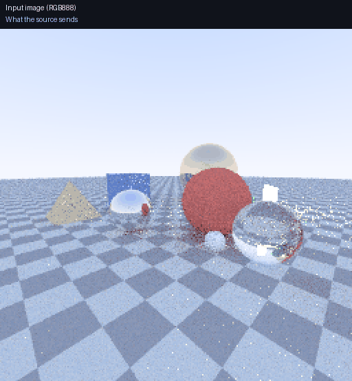

   

# Colourplay

Colourplay is a standalone image-processing project for Tiny Tapeout. A prepared
source supplies RGB pixels, the chip selectively changes their colours, and a
VGA output displays the result. The project is designed for learning streaming
image processing, module-level verification and display pipelines.

The RTL modules are port-complete templates. Each student implements one;
see [implementation tasks](docs/tasks.md).

- [Design documentation](https://adamahdavi.github.io/Colourplay/)
- [TinyTapeout 3D viewer](https://adamahdavi.github.io/Colourplay/gds/)
- [Introduction](docs/introduction.md)
- [Module interfaces](docs/modules/colourplay_if.md)
- [Implementation tasks](docs/tasks.md)
- [Editable architecture diagram](docs/diagrams/tt_um_colourplay.drawio)

## Visual demos

**[Open the filter playground](https://adamahdavi.github.io/Colourplay/demos/playground.html)**:
click an object to select its colour, then change tolerance, the run-length box
filter, hue angle and contrast. Only the selected object changes; the sky and ground are
left alone.



The GIF is generated by `test/colourplay_model.py`; the playground is a JavaScript
port of the same integer arithmetic. The RTL must match it bit for bit.

## Hierarchy

```text
tt_um_colourplay
├── io
├── ipu
│   ├── colour_detect
│   ├── hue
│   ├── contrast
│   └── bbox
└── vga
```

Module templates use explicit `i_`/`o_` ports grouped by their neighbouring module,
parameters where appropriate, and implementation hints rather than completed
solutions, following the author's
[PCS templates](https://github.com/AdaMahdavi/10G-Ethernet-Parser/tree/main/RTL/PCS).

## Build the documentation

```sh
python3 -m venv .venv
. .venv/bin/activate
pip install -r docs/requirements.txt
mkdocs build --strict
mkdocs serve
```

## Run the tests

With Icarus Verilog and Make installed:

```sh
pip install -r test/requirements.txt
make -C test
python3 test/colourplay_model.py   # model self-check, regenerates the GIF
```

The GDS workflow runs on every push and publishes
the spec site plus the TinyTapeout viewer (under `/gds/`) to GitHub Pages.
