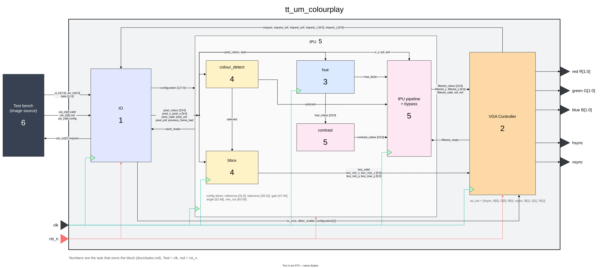

# Introduction

## Introduction to Colourplay

Colourplay is an image-processing design written in SystemVerilog for Tiny
Tapeout. An external source supplies a prepared image as a sequence of RGB
pixels. The chip identifies a colour range, applies selected effects, tracks
the selected region and displays the result through a VGA interface.

The first version is a standalone streaming image-processing prototype.
The source is an instructor-provided simulation harness that stores and replays
images. A physical implementation would require hardware that supplies the same
timed input and an external VGA DAC.

## Architectural Overview

*Click the diagram to open it full size.*

The top module instantiates three blocks:

- **IO** receives the formatted input, reconstructs RGB888 pixels and associates
  them with the coordinates requested by VGA. It also receives configuration.
- **IPU** contains Colour Detection, Hue, Contrast and Bounding Box Units.
  Detection uses the original pixel. Selected pixels pass through enabled effects;
  other pixels retain their original colour.
- **VGA** owns the raster counters, request scheduling, local scanout storage,
  bounding-box overlay, output quantization, blanking and synchronization.
  Timing is part of this module, not a separate top-level scheduler.

## Displaying an Image

VGA requests pixels ahead of their display positions. IO receives two input beats
per RGB888 pixel, and IPU processes the assembled pixel. VGA holds the result
until its raster position arrives, optionally draws a box and outputs RGB222.

The harness repeats the source image each refresh. There is no on-chip frame
buffer and no external-memory controller in the baseline. This is viable only
under the fixed-rate input contract; it is not a solution for a slow or
unpredictable renderer.

The baseline timing is 640 by 480 active pixels at a nominal 25 MHz pixel rate,
derived from a 50 MHz system clock using a clock enable. The design targets a
2x2 tile; the latency, storage and area budget is in
[Module Interface Contracts](modules/colourplay_if.md).

## Scope

Required work covers input assembly, colour selection, run-length noise
filtering, bounding-box tracking, hue rotation in 15 degree steps, selective
contrast and VGA scanout. Spatial filters, multiple-object detection and
physical tapeout are extensions, not prerequisites for the first demonstration.

The [filter playground](demos/playground.html) runs the same arithmetic as the
specification in a browser.
