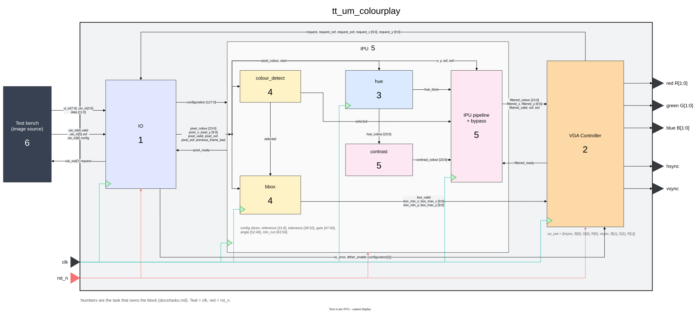

# `tt_um_colourplay` - Top-Level Module for Colourplay

## Overview

This module instantiates the Input Unit, Image Processing Unit and VGA Output
Unit. It connects the Tiny Tapeout pins to those blocks. Pixel arithmetic and
display timing belong to their respective units, not to the wrapper.

## Parameters

None at the wrapper level. The target clock is 50 MHz; this is a design target,
not a completed timing sign-off.

## Ports

The module uses the standard Tiny Tapeout ports: `ui_in[7:0]`, `uo_out[7:0]`,
`uio_in[7:0]`, `uio_out[7:0]`, `uio_oe[7:0]`, `clk`, `rst_n` and `ena`.
`ena` is unused, following the template's assumption that the design is selected.

See [Input Encoding](../encoding/input.md) for input pin allocation. VGA pins use:

```text
uo_out = {HSYNC, B[0], G[0], R[0], VSYNC, B[1], G[1], R[1]}
```

This matches the [TinyVGA playground example](https://github.com/TinyTapeout/vga-playground/blob/main/src/examples/stripes/project.v).
VGA colour pins require a DAC/adapter for a physical monitor; simulation does not.

## Architecture Overview

| Instance | Module | Connections |
|---|---|---|
| `u_io` | [`io`](io/io.md) | Input pins, VGA requests, active configuration, pixel output, error |
| `u_ipu` | [`ipu`](ipu/ipu.md) | Original pixels, filtered pixels, completed bounding box |
| `u_vga` | [`vga`](vga/vga.md) | Pixel requests, processed stream, box, display pins |

[](../diagrams/tt_um_colourplay.svg)

*Click the diagram to open it full size.*

## Implementation Status

Instances and interconnect are present. All child datapaths are skeletons with
`IMPLEMENTED = 0`. No image is displayed; IO asserts its error output to prevent
the scaffold from looking like working reception.
